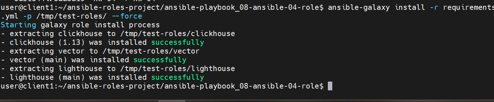
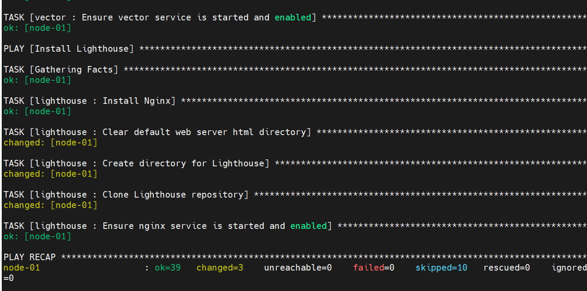
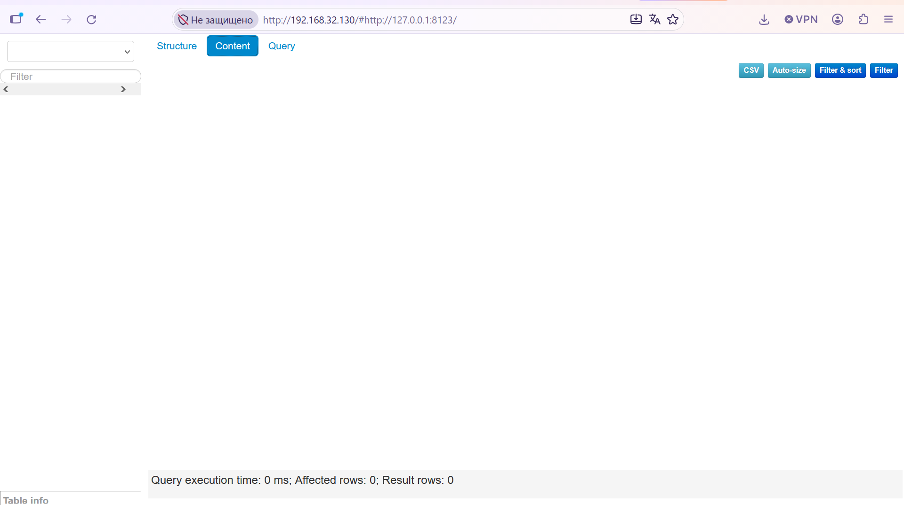

<details>
<summary><b>Задание</b></summary>
# Домашнее задание к занятию 4 «Работа с roles»

## Подготовка к выполнению

1. * Необязательно. Познакомьтесь с [LightHouse](https://youtu.be/ymlrNlaHzIY?t=929).
2. Создайте два пустых публичных репозитория в любом своём проекте: vector-role и lighthouse-role.
3. Добавьте публичную часть своего ключа к своему профилю на GitHub.

## Основная часть

Ваша цель — разбить ваш playbook на отдельные roles. 

Задача — сделать roles для ClickHouse, Vector и LightHouse и написать playbook для использования этих ролей. 

Ожидаемый результат — существуют три ваших репозитория: два с roles и один с playbook.

**Что нужно сделать**

1. Создайте в старой версии playbook файл `requirements.yml` и заполните его содержимым:

   ```yaml
   ---
     - src: git@github.com:AlexeySetevoi/ansible-clickhouse.git
       scm: git
       version: "1.13"
       name: clickhouse 
   ```

2. При помощи `ansible-galaxy` скачайте себе эту роль.
3. Создайте новый каталог с ролью при помощи `ansible-galaxy role init vector-role`.
4. На основе tasks из старого playbook заполните новую role. Разнесите переменные между `vars` и `default`. 
5. Перенести нужные шаблоны конфигов в `templates`.
6. Опишите в `README.md` обе роли и их параметры. Пример качественной документации ansible role [по ссылке](https://github.com/cloudalchemy/ansible-prometheus).
7. Повторите шаги 3–6 для LightHouse. Помните, что одна роль должна настраивать один продукт.
8. Выложите все roles в репозитории. Проставьте теги, используя семантическую нумерацию. Добавьте roles в `requirements.yml` в playbook.
9. Переработайте playbook на использование roles. Не забудьте про зависимости LightHouse и возможности совмещения `roles` с `tasks`.
10. Выложите playbook в репозиторий.
11. В ответе дайте ссылки на оба репозитория с roles и одну ссылку на репозиторий с playbook.

---

### Как оформить решение задания

Выполненное домашнее задание пришлите в виде ссылки на .md-файл в вашем репозитории.

---


</details>

-----
-----


<details>
<summary><b>Ответ</b></summary>
## Описание проделанной работы
В рамках выполнения домашнего задания были исправлены ошибки в локальных ролях, настроен файл зависимостей `requirements.yml` со ссылками на персональные репозитории, а также успешно запущен плейбук `site.yml`.

### 1. Исправление роли Vector
* Версия Vector обновлена на `0.39.0`.
* Исправлен URL скачивания с GitHub Releases под формат deb-пакета (`amd64`).
* Для установки скачанного пакета использован модуль `apt`.

### 2. Исправление роли LightHouse
* Перед клонированием добавлено удаление стандартной директории Nginx `/var/www/html` через `ansible.builtin.file` (`state: absent`).
* В конфигурации Nginx убран нерабочий `proxy_pass` и настроена раздача статических файлов напрямую из `/var/www/html`.

## Ссылки на репозитории ролей
* Vector: https://github.com/alexandr-bobkov/vector-role
* LightHouse: https://github.com/alexandr-bobkov/lighthouse-role

## Проверка установки ролей через requirements.yml
Корректность скачивания ролей из внешнего репозитория и персональных форков проверена командой:
```bash
ansible-galaxy install -r requirements.yml -p /tmp/test-roles/ --force
```
> 📸 ** Корректность скачивания ролей:** 📸
> 

## Проверка отработки плейбука
> 📸 ** Отработка плейбука:** 📸
> 

## Страница LightHouse
> 📸 ** Страница LightHouse:** 📸
> 


</details>

-----
-----
